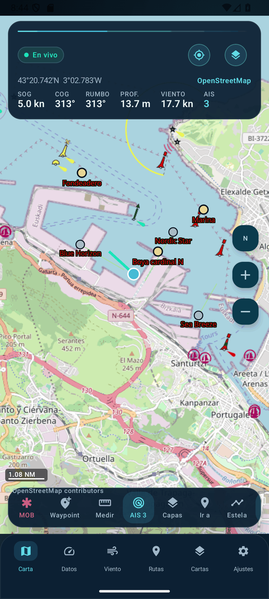
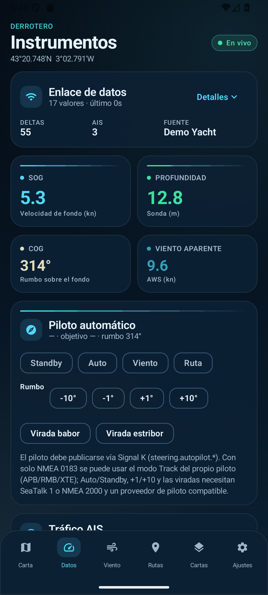
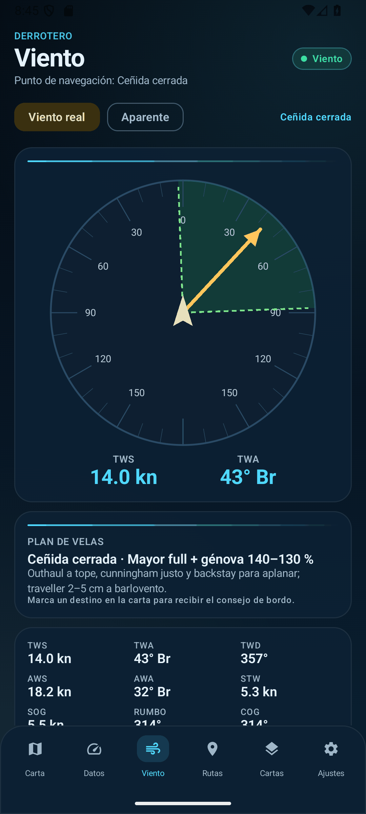
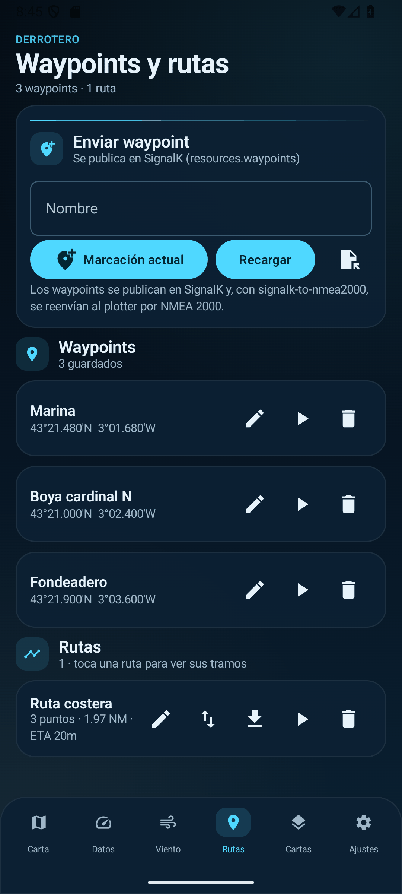
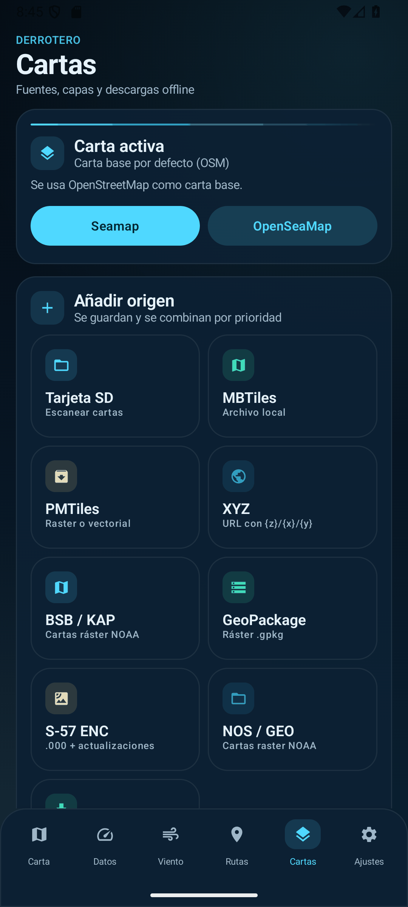
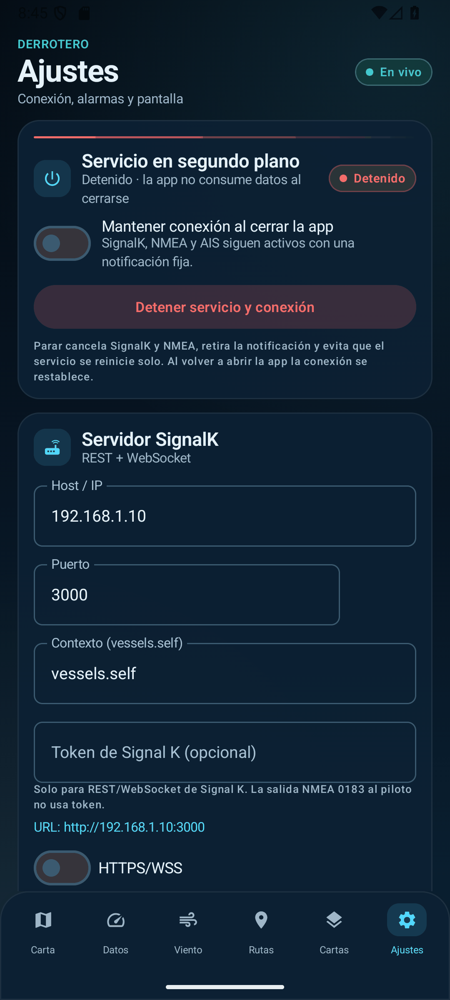

# Derrotero

Compañero Android de navegación que se conecta a **Signal K** y a redes NMEA 0183/2000.
Funciona con cualquier servidor Signal K y con plotters que expongan esos datos; se ha
probado con un plotter B&G/Navico, pero no depende de ninguna marca.

* **Datos del barco** desde **Signal K** (REST + stream WebSocket de deltas).
* **Envío y gestión de waypoints y rutas** vía la API `resources` de Signal K.
* **Cartas**: MBTiles, PMTiles, BSB/KAP, NOS/GEO, S-57 ENC, GeoPackage y capas XYZ/estilos
  (OpenStreetMap, OpenSeaMap, EMODnet, Seamap), locales o por red.
* **Escaneo de la tarjeta SD**: localiza GPX/KML/CSV de usuario y paquetes de cartas
  MBTiles/GeoPackage en una tarjeta extraíble.

> ⚠️ **Aviso de seguridad.** Derrotero es una ayuda a la navegación, **no** un
> instrumento homologado ni un sustituto de las cartas oficiales. Los datos de cartas,
> AIS y sensores pueden ser incompletos o incorrectos. No lo uses como medio primario de
> navegación y mantén siempre el control manual del barco, especialmente al usar el
> piloto automático.

> **Marcas.** Derrotero no está afiliado, patrocinado ni respaldado por Navico, B&G,
> Simrad, Lowrance, Raymarine, Garmin/Navionics ni OpenCPN. Los nombres de producto se
> usan únicamente para describir compatibilidad.

**Repositorio:** <https://github.com/juansoler/derrotero>

## Capturas de pantalla

| Carta | Instrumentos | Viento |
|---|---|---|
|  |  |  |

| Waypoints y rutas | Cartas | Ajustes |
|---|---|---|
|  |  |  |

*Capturas tomadas en modo demo: los datos de posición, viento, AIS y rumbo son simulados.*

---

## 0. Cambios de la versión 0.9.4

### Publicación como proyecto abierto

* Añadida la licencia **Apache-2.0**, `NOTICE`, avisos de terceros y una pantalla de
  licencias en **Ajustes → Acerca de**.
* Aviso de seguridad y de no afiliación en la primera ejecución.
* La descarga masiva de teselas queda desactivada para los proveedores que no la permiten
  (OpenStreetMap, OpenSeaMap); solo se permite en plantillas XYZ propias o fuentes con
  permiso explícito.
* Icono original de la app.

### Salida al piloto por UDP a Signal K y de Signal K al puerto serie

* **Arquitectura corregida**: la app envía `APB`, `RMB`, `RMC` y `XTE` por **UDP** al servidor
  **Signal K** (el mismo host del servidor, puerto UDP de la conexión NMEA 0183, habitualmente
  `10119`). Signal K recibe las frases y las reenvía al piloto por su **puerto serie**; la app
  **no** se conecta directamente al gateway ni necesita token.
* **Nuevo selector de transporte** en Ajustes → NMEA 0183 → *Salida al piloto automático*:
  **UDP (Signal K)** —valor por defecto— o **TCP (gateway directo)**, este último para
  multiplexores y pilotos que escuchan directamente en TCP.
* **Una frase NMEA por datagrama**, con terminación CRLF, que es el formato que espera la
  conexión UDP de Signal K y la mayoría de multiplexores NMEA.
* **Host y puerto de salida propios**, independientes de la entrada NMEA. Con UDP el host es
  obligatorio; el botón **«Usar host de Signal K»** lo rellena desde la configuración del
  servidor. Con TCP se pueden dejar vacíos para heredar los de la entrada TCP.
* En Signal K hay que crear una conexión **Data Connections → NMEA 0183 → UDP :10119** con
  evento de entrada `autopilot`, y una conexión **serie** al ST4000+ con eventos de salida
  `autopilot` y el baudios correcto. La app envía; Signal K traduce y reenvía.
* El piloto sigue teniendo que estar en **modo Track/Nav**. Auto/Standby, ±1°/±10° y las
  viradas no forman parte de NMEA 0183 estándar.

---

## 0. Cambios de la versión 0.9.3 (histórico: salida TCP directa)

### Salida NMEA al piloto independiente de la entrada

* **Corregido el caso del ST4000+ que mostraba «NO DATA»**: la salida al piloto ya no
  reutiliza el socket de entrada NMEA. Tiene **su propia conexión TCP** y funciona aunque los
  datos del barco lleguen por Signal K y la entrada NMEA esté desactivada.
* **Host y puerto del piloto propios** en Ajustes → NMEA 0183. Si se dejan vacíos se usan los
  de la entrada TCP; con la entrada desactivada o UDP hay que indicarlos. Es el mismo destino
  que OpenCPN configura en **«Transmitir en este puerto»** (por ejemplo
  `192.168.1.103:10119`).
* **Frases compatibles con OpenCPN**: `RMB`, `RMC`, `APB` y `XTE`, con talker `EC`, en el
  mismo orden y con el **indicador de modo NMEA 2.3** en `RMB`/`RMC` y el ID de origen en
  `RMB`. Así el piloto recibe exactamente el mismo formato que le funciona con OpenCPN.
* **Diagnóstico de salida**: estado de la conexión, destino, número de frases enviadas y
  último error, separado del diagnóstico de entrada.
* La conexión de salida es **solo de escritura**: no hace falta que el gateway del piloto
  devuelva datos. Si OpenCPN y la app usan el mismo gateway, cierra OpenCPN mientras navegas
  con Derrotero (algunos multiplexores aceptan un único cliente TCP).
* El piloto sigue teniendo que estar en **modo Track/Nav**. Auto/Standby, ±1°/±10° y las
  viradas no forman parte de NMEA 0183 estándar.

---

## 0. Cambios de la versión 0.9.2

### Estela visible y fiable

* **Corregido el orden de capas**: al recargar las cartas, las teselas raster y S-57 se
  insertaban por encima de la estela y podían ocultarla. Ahora todas las cartas van bajo un
  ancla invisible situada en el fondo del estilo, y la estela, el rumbo, la corriente y las
  rutas quedan siempre por encima.
* **Traza más legible**: línea magenta con borde oscuro, cortada en segmentos cuando hay un
  salto de posición o más de 30 minutos sin datos (evita líneas rectas falsas tras perder el
  GPS o reiniciar la app). Se dibujan como máximo los últimos 5.000 puntos.
* **Activar Estela** en el mapa ya no deja la pantalla sin cambios: enciende también la
  visualización y registra de inmediato la posición actual, aunque el barco aún no se mueva.

### Vista de viento adaptable

* **Sin círculo cortado en tablet**: el dial ya no fuerza una altura igual al ancho de la
  pantalla dentro de una columna con scroll. Se dibuja en un espacio flexible y siempre usa
  el menor de ancho/alto disponibles.
* **Tablet en horizontal**: distribución en dos columnas (dial + laylines a la izquierda;
  plan de velas, métricas y polares a la derecha) que cabe **sin scroll**.
* **Móvil o pantalla estrecha**: se mantiene la columna con scroll, pero el dial queda
  limitado a la altura disponible y nunca se parte.
* **Marcador de destino** amarillo en el dial, relativo a proa, para ver de un vistazo si el
  destino está dentro de la zona muerta o de una banda de ceñida.

### Consejo de velas y de bordo

* **Plan de velas** según el rumbo al destino (o el TWA actual) y el TWS: punto de navegación,
  velas recomendadas y ajuste básico (rizos, génova, escotas, vang, preventer…). Usa la tabla
  de polares para el ángulo de ceñida si está disponible.
* **Destino proa al viento**: cuando la demora al destino cae dentro de la zona muerta, la app
  propone el **rumbo de ceñida** por la banda que más acerca al destino e indica la amura
  (babor/estribor).
* **Aviso de bordo**: cuando el destino cruza el eje del viento y el barco sigue en la amura
  contraria, aparece **«¡Bordo!»** en el HUD del mapa y en la tarjeta de viento, y se envía
  una **notificación** (canal «Navegación y bordo», ID 4804) con el rumbo sugerido.
* **Etiquetas de punto de navegación corregidas**: «Proa al viento», «Ceñida cerrada»,
  «Ceñida», «Ceñida abierta», «Través», «Largo», «Aleta» y «Popa».
* El consejo es orientativo y asume un velero de crucero/regata medio: no sustituye al juicio
  del patrón, las condiciones reales del mar ni la carta oficial.

---

## 0. Cambios de la versión 0.9.1

### Salida NMEA 0183 al piloto automático (sin token)

* **`NMEA 0183 (Wi-Fi)` → Enviar guía al piloto**: la conexión TCP pasa a ser bidireccional y
  emite `APB`, `RMB`, `RMC` y `XTE` una vez por segundo, igual que OpenCPN. El piloto debe
  estar en **modo Track/Nav**; no hace falta Signal K ni ningún token, porque NMEA 0183 es un
  flujo crudo sin autenticación.
* **`Ir aquí` / rutas**: con la salida activa, la app ya no muestra el error *«Configura el
  token de Signal K»*: la guía llega al piloto por el TCP y el mensaje lo indica. Signal K se
  sigue usando para guardar rutas si está disponible.
* **Panel del piloto**: en Datos se explica el modo activo. Auto/Standby, ±1°/±10° y las
  viradas **no existen en NMEA 0183 estándar** (son SeaTalk/NMEA 2000): si Signal K devuelve
  401/403, el aviso ahora remite a la salida NMEA y al modo Track en vez de pedir el token a
  secas.
* **Token de Signal K**: el campo de Ajustes se etiqueta como exclusivo de REST/WebSocket; la
  salida NMEA al piloto no lo utiliza.
* **Parser APB/XTE corregido**: se leían mal los campos de APB estándar y la variante
  `$--XTE,A,A,...`; ahora ambas se decodifican bien.
* **Contador de salida** en Ajustes (`enviadas`) y error de escritura separado del de entrada.

---

## 0. Cambios de la versión 0.9.0

### Servicio en segundo plano y notificación

* **Botón PARAR en la notificación**: la notificación del servicio muestra una barra con los
  datos en vivo (posición, SOG/COG, rumbo, profundidad, viento y número de blancos AIS) y una
  acción **PARAR** que corta Signal K, NMEA, el GPS y la estela, retira la notificación y evita
  que el servicio se reinicie solo (`START_NOT_STICKY`).
* **Ajustes → Servicio en segundo plano**: muestra si está activo y ofrece el interruptor de
  arranque persistente y un botón **Detener servicio y conexión**. Al volver a la app se
  reconecta solo si el interruptor sigue activo.
* La app ya no queda viva de forma invisible: al detener el servicio no quedan conexiones en
  segundo plano ni se reengancha tras reiniciar el proceso.

### Interfaz

* **Nueva identidad visual marina**: fondo profundo con degradados, tarjetas de cristal,
  cabeceras de pantalla, indicadores de estado y tiles de instrumento consistentes en
  Instrumentos, Viento, Waypoints/Rutas, Cartas, Ajustes y Piloto automático.
* **Mapa**: HUD compacto con posición, SOG/COG/rumbo, profundidad, viento, AIS y guiado activo;
  **dock inferior** de acciones (MOB, waypoint, medir, AIS, capas, ir a, estela, vectores) y
  selector rápido de carta base con una sola pulsación.
* **Cartas**: pantalla rediseñada como panel de fuentes, capas y descargas, con accesos
  directos a SD, MBTiles, PMTiles, XYZ, BSB/KAP, GeoPackage, S-57, NOS/GEO y descarga de área.

### Fiabilidad de las cartas

* **Carga robusta**: si un estilo remoto o local no termina de cargar en 15 s, la app muestra
  el error, permite **Reintentar** o **Usar OSM** y cae automáticamente a OpenStreetMap para
  que el mapa nunca quede en negro. Las capas se reconstruyen de una sola vez al cambiar de
  estilo.
* **Cambio de carta sin reiniciar la app** desde el propio mapa; el estilo se recarga cuando
  cambia su contenido o el puerto local de teselas.
* **MBTiles** se copian a `filesDir` (antes a `cacheDir`, que Android puede vaciar y dejaba la
  carta en blanco). **PMTiles** conserva el permiso SAF persistente para reabrirse tras
  reiniciar. **GeoPackage** usa el tamaño de tesela real de `gpkg_tile_matrix`.
* El servidor local de teselas escucha **solo en 127.0.0.1** y cachea glifos y sprites para
  que los estilos vectoriales funcionen sin red tras la primera carga.

---

## 0. Cambios de la versión 0.8.0

### Símbolos de balizas y piloto automático

* **Símbolos S-52 para puntos**: boyas laterales (rojo/verde), cardinales, aguas seguras,
  peligro aislado, especiales, luces, pecios, rocas, obstrucciones y muertos se dibujan con
  iconos propios generados en tiempo de ejecución (sin assets externos), además de la etiqueta
  y el color.
* **Piloto automático**: `+1°`/`+10°` usan ahora la acción estándar de Signal K
  `steering.autopilot.actions.adjustHeading` (valor en grados), con respaldo al rumbo objetivo
  absoluto si el proveedor no implementa la acción. Así funciona con `signalk-autopilot`.
* **Raymarine ST4000+**: documentado el flujo completo (NMEA 0183 / SeaTalk) en la sección 13.

### Actualizaciones S-57 y simbología de luces (0.7.0)

* **Celdas de actualización `.001`, `.002`…**: se localizan junto a la celda base (o se
  seleccionan a la vez) y se aplican en orden con los indicadores S-57 `RUIN`
  (1 insertar, 2 borrar, 3 modificar). Se actualizan geometrías y atributos, y la carta
  indica cuántas actualizaciones lleva aplicadas (`2 act.`).
* **Sectores de luz S-52**: `SECTR1`/`SECTR2`, `COLOUR` y `VALNMR` generan las cuñas de
  sector coloreadas alrededor de cada luz.
* **Etiquetas de luces**: características (`LITCHR`), grupo (`SIGGRP`), periodo (`SIGPER`),
  altura (`HEIGHT`) y alcance (`VALNMR`) en notación S-52 simplificada
  (`Fl(1) G 2.5s 4.6m 3M`).
* **Selección múltiple** al abrir una ENC: celda base + actualizaciones. Las actualizaciones
  se copian junto a la base y se vuelven a aplicar al restaurar la carta.

### S-57 ENC y NOS/GEO (0.6.0)

* **S-57 ENC (`.000`)**: lector propio de **ISO/IEC 8211** (líder, directorio, campos y
  subcampos) y de los objetos S-57 (`FRID`, `FOID`, `FSPT`, `VRID`, `VRPT`, `SG2D`, `SG3D`,
  `ATTF`). Reconstruye la topología de nodos, ejes y caras, lee atributos (`OBJNAM`,
  `DRVAL1/2`, `CATLAM`, `COLOUR`, `LITCHR`…), la cobertura `M_COVR` y la escala de compilación
  `CSCL`. Se dibuja como capa vectorial (GeoJSON) con una paleta S-52 simplificada:
  áreas de profundidad, tierra, costas, contornos, balizas, luces, pecios, zonas restringidas,
  sectores y sondas. El rango de zoom se deriva de la escala de la carta.
* **NOS/GEO**: variante antigua de BSB cuya georreferencia está en el fichero `.geo`
  (`Point=lon lat line pixel`). Se seleccionan conjuntamente `.nos` y `.geo`.
  En `tools/samples/US5CA13M.000` (con `.001` y `.002`) hay una celda **ENC real de NOAA**
  (San Francisco, dominio público) para probar el lector S-57; se pueden descargar más en
  `https://charts.noaa.gov/ENCs/`.
* **Formatos no soportados con aviso claro**: S-63 cifrado (`.os63`, requiere User Permit),
  BSB4 (`.cap`), NV Charts (`.eap`) y Fugawi (`.bap`) explican el motivo en lugar de fallar
  con un error genérico.
* **Limitaciones S-57**: los estilos S-52 son una aproximación (faltan el catálogo completo
  de símbolos, `SCAMIN`, balizas con formas y simbología avanzada); CM93 v2 y S-63 no se
  implementan por ser propietarios o requerir licencias.

### Cartas de OpenCPN: BSB/KAP y GeoPackage (0.5.0)

* **BSB/KAP** (`.kap`, `.bsb`): el formato ráster clásico de NOAA/Maptech, el que usa
  OpenCPN para las cartas oficiales de EE. UU. Se lee **nativamente**, sin GDAL ni conversión:
  - cabecera `BSB/`, `KNP/` (escala, datum y proyección), `REF/` y `PLY/` (cobertura);
  - **paleta `RGB/`** embebida (y respaldo en grises si la carta no la trae);
  - **RLE BSB** por scanline, con marcadores de línea en base 128 y tabla de índices al final
    (o recorrido secuencial si la carta no la tiene);
  - georreferenciación **Mercator exacta** ajustada por mínimos cuadrados a los `REF/`, con
    respaldo lineal para proyecciones transversales;
  - renderizado a teselas PNG bajo demanda, con **promediado en miniatura** para que no
    desaparezcan líneas de costa ni sondas al alejar.
  Se muestra la cobertura, la escala y el datum en la lista de cartas.
* **GeoPackage** (`.gpkg`): pirámides de teselas estándar (PNG/JPEG), con cobertura desde
  `gpkg_contents` (WGS84 o Web Mercator) y rango de zooms desde la tabla `tiles`. Las cartas
  GeoPackage **vectoriales** (tablas de features) se detectan y se avisa de que aún no se
  renderizan.
* Ambas se **copian a `filesDir/charts`** y se restauran al arrancar, así que el permiso SAF
  caducado no rompe la carta.
* `tools/make_sample_charts.py` genera una carta KAP y un GeoPackage de prueba (Santander) con
  la misma carta dibujada, útil para probar los lectores sin datos reales. Deja los ficheros en
  `tools/samples/` (`santander-test.kap` y `santander-test.gpkg`).

### Arreglos de lectura de Signal K

Estos eran los fallos que hacían que la app "conectara" pero no mostrara los datos del barco:

1. **El contexto del propio barco se descartaba.** En un servidor real los deltas llegan con
   `context = "vessels.urn:mrn:imo:mmsi:…"`, no con `"vessels.self"`. El filtro antiguo tiraba
   **todos** los datos propios. Ahora se resuelve `GET /signalk/v1/api/self` y se usa ese URN
   (con el MMSI como respaldo).
2. **La reconexión no existía.** El flujo terminaba tras un error y `collectLatest` no volvía a
   arrancarlo. Ahora hay dos bucles de stream con espera exponencial (0,75 s → 15 s).
3. **El barco propio aparecía como objetivo AIS**, por el mismo problema del URN.
4. **Stream congelado al perder el Wi-Fi.** Un socket medio abierto no se detectaba; ahora un
   *watchdog* cierra el stream tras 90 s sin mensajes y reconecta.
5. **El modelo REST solo se pedía una vez.** Se refresca al reconectar y cada 3 minutos para
   rellenar rutas que el stream no publica.
6. **Rutas reales sin puntos.** La API `resources.routes` referencia los waypoints por `href`
   (`{"href": "/resources/waypoints/<id>"}`), no con coordenadas incrustadas. Ahora se resuelven
   (con la colección de waypoints cacheada, sin N peticiones).
7. **Waypoint creado pero no editable.** Si el servidor no devolvía `Location`, la app se quedaba
   con un id local distinto del real. Ahora se lee `Location`, el cuerpo o se hace `PUT` con el
   id generado.
8. **Unidades no estándar.** Se normalizan ángulos publicados en grados, temperatura en °C y
   presión en hPa; y la profundidad usa `belowTransducer` → `belowKeel` → `belowSurface`.
9. **Deltas con `meta` sin `value`** rompían la deserialización y se perdía el mensaje completo.
10. **Host pegado como URL completa** (`http://ip:3000/signalk/v1/api`) generaba URLs inválidas.
    Ahora se normaliza, se admite token Bearer y los errores HTTP se explican en Ajustes.

Además, cambiar cualquier preferencia (alarmas, polar, luz nocturna…) reiniciaba la conexión;
ahora solo lo hacen los cambios de servidor.

### Funciones nuevas inspiradas en OpenCPN

* **Guía de navegación**: DTW, demora, **XTE** con lado (estribor/babor), VMG, tiempo restante y
  **ETA** en el HUD y en Datos.
* **Alarma de llegada y de fuera de rumbo**, con radio de llegada y límite de XTE configurables, y
  **avance automático al siguiente waypoint** de la ruta activa.
* **MOB (hombre al agua)**: botón rojo, marca persistente en la carta, línea y distancia/demora, y
  notificación de alta prioridad.
* **Herramienta de medición**: dos toques en la carta y distancia/demora entre los puntos.
* **Vectores de predicción AIS** a 6 minutos (Signal K y AIS de Internet).
* **Luz nocturna** (atenuación 0–80 %) y tema marino oscuro.
* **Exportar a GPX** la estela, los waypoints y las rutas (compatible con OpenCPN).
* **Invertir ruta** y estadísticas por ruta (distancia total y ETA a la SOG actual).
* **Diagnóstico de conexión** en Ajustes/Datos: self resuelto, MMSI, último delta, deltas
  recibidos, valores, estado del stream y último error.
* **NMEA 0183 por Wi-Fi (TCP o UDP)**: GPS, rumbo, viento, profundidad, temperatura, rutas/XTE y
  **AIS `!AIVDM`** (tipos 1/2/3/5/18/19/24) decodificado al mismo pipeline que Signal K. La
  conexión TCP también puede **emitir APB/RMB/RMC/XTE al piloto** (modo Track, sin token).
  Signal K mantiene prioridad mientras está en vivo; NMEA rellena huecos y toma el relevo si cae.
* **Lista de objetivos AIS (estilo OpenCPN)**: ordenada por distancia, filtros *Todos / Peligro /
  Clase A / En movimiento*, CPA/TCPA por contacto, centrar la carta y crear waypoint sobre el
  objetivo.
* **Colores AIS por tipo de buque** (carga, tanque, pasaje, pesquero, remolcador…) y **halo rojo**
  en los objetivos que disparan CPA/TCPA o zona de guardia.
* **Piloto automático**: panel con Standby/Auto/Viento/Ruta, ajuste de rumbo ±1°/±10° y viradas
  babor/estribor mediante la API `steering.autopilot.*` de Signal K. La guía de ruta
  (`APB/RMB/RMC/XTE`) se puede enviar por NMEA 0183 TCP sin token; el piloto debe estar en modo
  Track.
* **Corriente (set & drift)**: rumbo y deriva en Datos y **flecha de corriente** en la carta
  (una hora de deriva desde el barco).
* **Renombrar waypoints y rutas** desde Rutas, manteniendo la guía activa sincronizada.
* **Biblioteca de cartas persistente**: las cartas añadidas se guardan y se restauran al
  arrancar, con cobertura, activación/desactivación y **prioridad de pintado (quilt)**.
* **Panel de capas**: AIS, waypoints, ruta, estela, rumbo, corriente, círculo de llegada,
  vectores, escala, compás, seguir barco y rumbo arriba.
* **Escala gráfica, compás, rumbo arriba y seguir barco** (estilo OpenCPN).
* **Ir a posición**: coordenadas decimales, grados/minutos o DMS, y búsqueda por nombre de
  waypoint, con acciones **Ir** (piloto) o **Centrar**.

---

## 1. Stack

* Kotlin 2.0 + **Jetpack Compose** (Material 3)
* `minSdk 26`, `targetSdk 35`
* **MapLibre Native** para el mapa (sin API key)
* **OkHttp** (REST) + **WebSocket** para el stream de SignalK
* **kotlinx.serialization**
* **NanoHTTPD** para servir MBTiles locales como `http://127.0.0.1:<puerto>/{z}/{x}/{y}.png`
* **SAF** (`DocumentFile`/`OpenDocumentTree`) para leer la SD sin permisos root

## 2. Compilar

Necesitas **Android Studio** (Ladybug o superior) con JDK 17 y el Android SDK 35.

```bash
git clone https://github.com/juansoler/derrotero.git
cd derrotero

# Abre esta carpeta en Android Studio, o:
./gradlew :app:assembleDebug
```

Instala `app/build/outputs/apk/debug/app-debug.apk` en el móvil/tablet.

> Las versiones de dependencias están en `gradle/libs.versions.toml`; ajústalas a las que
> tengas disponibles en tu SDK.

## 3. Configurar SignalK

1. Ten un **SignalK server** en la red del barco (Raspberry, plotter con signalk-node-server, etc.).
2. En la app → **Ajustes**: host/IP, puerto (por defecto **3000**), HTTPS/WSS si aplica, el
   contexto (`vessels.self`) y, si el servidor tiene seguridad activada, el **token de acceso**
   (se envía como `Authorization: Bearer …`). El campo de host acepta tanto `192.168.1.10` como
   una URL completa (`http://192.168.1.10:3000/signalk/v1/api`).
3. Pulsa **Probar**: la app muestra la versión del servidor, la URL normalizada, el **self
   resuelto** (`vessels.urn:mrn:imo:mmsi:…`) y si el modelo REST responde.
4. Los datos aparecen en **Datos** y la posición en la **Carta**. En Ajustes y en Datos tienes el
   diagnóstico en vivo (último delta, deltas recibidos, estado del stream, último error).

### Enviar waypoints al plotter

La app publica waypoints en `resources.waypoints` de SignalK. Para que un plotter
Raymarine/Navico los reciba por **NMEA 2000**, instala en el servidor los plugins:

```
signalk-to-nmea2000      # convierte waypoints/rutas a PGN 130074
```

(y el interface N2K correspondiente, p. ej. `@canboat/canboatjs` + `signalk-canbus` /
`signalk-n2k-*`). Así "enviar waypoint" pasa a ser visible en el plotter.

### NMEA 0183 por Wi-Fi

La app puede leer directamente un **multiplexor NMEA 0183** de la red del barco, sin Signal K:

1. **Ajustes → NMEA 0183 (Wi-Fi)**.
2. Elige **TCP (cliente)**: host del multiplexor y puerto (habitual **10110**), o **UDP
   (escucha)**: la app se queda escuchando en el puerto indicado (los receptores suelen hacer
   *broadcast*).
3. Activa y pulsa **Guardar NMEA**. El estado muestra frases recibidas, propias, AIS, errores de
   checksum/parseo y la última frase.

La **salida al piloto** es independiente: en la misma tarjeta, activa *Enviar guía al piloto* e
indica el host/puerto del gateway del piloto (o déjalos vacíos para usar los de la entrada TCP).
No hace falta activar la entrada NMEA si los datos llegan por Signal K.

Frases soportadas: `GGA`, `RMC`, `GLL`, `VTG`, `HDT`, `HDM`, `VHW`, `DPT`, `DBT`, `MTW`, `MWV`,
`VWR`, `MDA`, `GSA`, `RMB`, `BWC`, `BWR`, `APB` y `XTE`. Se convierten a unidades Signal K.

**AIS**: se ensamblan los mensajes multiparte `!AIVDM` y se decodifican los tipos **1/2/3**
(posición clase A), **5** (estático clase A), **18/19** (clase B) y **24** (estático clase B). Los
objetivos aparecen en la carta, la lista de Datos, CPA/TCPA, alarmas y vectores exactamente igual
que los AIS de Signal K.

**Prioridad**: mientras Signal K está en vivo, sus valores mandan y NMEA solo rellena los paths que
Signal K no publica (p. ej. profundidad). Si Signal K cae, NMEA toma el relevo; al volver, Signal K
recupera la prioridad. El estado pasa a **NMEA 0183**.

> Para **NMEA 2000** no se conecta un adaptador CAN directamente: lo habitual es usar Signal K con
> `canboatjs`/`signalk-n2k-*`, o un multiplexor que convierta N2K a NMEA 0183. La app ya cubre ambas
> rutas.

## 4. Tarjeta SD

1. Inserta la tarjeta en el Android (o usa un lector USB-OTG).
2. En **Cartas → Escanear SD** elige la raíz de la tarjeta (selector SAF del sistema).
3. La app informa de:
   * **GPX/KML/CSV** de usuario (importables a Signal K y al plotter),
   * paquetes **MBTiles/GPKG** (se pueden añadir como carta).

Derrotero no lee formatos de carta propietarios ni cifrados. Usa cartas en
formatos abiertos o exportadas por ti en MBTiles/GeoPackage.

### Ver cartas en Android

| Opción | Cómo |
|---|---|
| **Seamap** (náutica vectorial) | Ya incluida. Estilo MapLibre `https://tiles.openwaters.io/seamap/style.json` (z0–14), con batimetría, balizas IALA, luces con sectores, peligros… |
| Capas abiertas | OpenSeaMap (señales), OpenStreetMap, EMODnet. |
| Cartas MBTiles/GPKG | Tenlas en la SD → **Cartas → Añadir MBTiles**. Se copian al almacenamiento de la app y se sirven en local. |
| Capa XYZ propia | **Cartas → XYZ** con la plantilla `…/{z}/{x}/{y}.png`. |
| Cartas desde SignalK | Plugins de cartas de SignalK publican fuentes en `resources.charts` (hook preparado vía `ChartKind.SIGNALK`). |

Ejemplos de cartas abiertas convertibles a MBTiles: **NOAA ENC**, **OpenSeaMap**, **GEBCO**,
**EMODnet Bathymetry**, **OpenCPN/oeSENC** (con su licencia), etc.

## 5. Estructura

```
app/src/main/java/com/derrotero/
├── core/AppContainer.kt              # DI mínima + arranque de la conexión
├── data/
│   ├── settings/SettingsStore.kt     # DataStore: endpoint SignalK, carta activa, SD
│   ├── signalk/                      # SignalKModels, SignalKFlatten, SignalKClient (REST+WS)
│   ├── nmea/                         # NMEA0183 parser + AIS (AIVDM) + TCP/UDP reader
│   ├── vessel/                       # VesselRepository (2 streams+demo), AIS, NavMonitor, MOB
│   ├── resources/                    # Waypoint/Route + API resources de SignalK (hrefs)
│   ├── charts/                       # ChartSource, MBTiles/PMTiles, LocalTileServer, offline downloader
│   ├── polar/Polar.kt                # tabla de polares + VMG óptimo
│   ├── demo/DemoData.kt              # waypoints/rutas de prueba
│   └── sd/                           # SdCardScanner, GpxParser, GpxWriter
├── service/                          # SignalKService (foreground) + ServiceController
├── ui/
│   ├── NavApp.kt, NavViewModel.kt
│   ├── map/MapScreen.kt              # MapLibre + cartas + vessel + AIS + waypoints
│   ├── instruments/InstrumentsScreen.kt
│   ├── waypoints/WaypointsScreen.kt
│   ├── charts/ChartsScreen.kt
│   └── settings/SettingsScreen.kt
└── util/                             # Geo, WindMath, Cpa, Formatters
tools/mock_signalk.py                 # servidor SignalK de prueba (stdlib, sin dependencias)
tools/selftest_signalk.py             # test de regresión: URN self, subscribe, hrefs, token
tools/mock_nmea.py                    # multiplexor NMEA 0183 TCP de prueba (GPS + AIS)
```

## 6. Limitaciones conocidas

* **Formatos propietarios** (CM93, S-63 cifrado, BSB4, NV Charts): no
  soportados. La app no descifra ni elude protecciones de ningún formato.
* **S-57**: se lee la celda base `.000` y se aplican las actualizaciones `.001`, `.002`…
  Los estilos S-52 son una aproximación: hay áreas de profundidad, tierra, costas, balizas,
  luces con **sectores y etiquetas**, pecios y sondas, pero faltan el catálogo completo de
  símbolos, `SCAMIN` y la simbología avanzada de balizas. Las etiquetas usan los glifos del
  estilo base (Noto Sans): sin red ni glifos en caché no se dibujan, aunque el resto de la
  carta sí.
* **S-63, CM93 v2, BSB4, NV Charts y Fugawi**: no soportados. S-63 es S-57 cifrado con User
  Permit (licencias o-charts); CM93 v2 es propietario y está descatalogado; BSB4/NV/Fugawi solo
  funcionan con plugins propietarios de OpenCPN.
* **Quilting**: se combinan cartas locales por prioridad y una base remota; no se seleccionan
  automáticamente la escala/carta preferida como OpenCPN.
* **NMEA 2000**: no se conecta un adaptador CAN directamente. Se usa Signal K
  (`canboatjs`/`signalk-n2k-*`) o un multiplexor N2K→NMEA 0183; la app cubre ambas rutas.
* **NMEA 0183**: entrada por **TCP/UDP** y salida de guía al piloto (`APB/RMB/RMC/XTE`) por
  **UDP a Signal K** (que la reenvía al puerto serie) o por **TCP directo** a un gateway; el
  puerto serie USB y Bluetooth SPP quedan como siguientes pasos.
* **Piloto automático**: el panel de modos requiere un plugin de Signal K que implemente
  `steering.autopilot.*`; la guía de ruta también puede salir por NMEA 0183 (UDP a Signal K o
  TCP directo) sin token (sección 13).
* **Corriente (set & drift)**: se toma de Signal K (`environment.current.*`); NMEA 0183 no tiene
  una frase estándar de corriente.
* `activateRoute` usa `navigation.course.activeRoute`; el soporte varía según servidor. La guía
  (DTW/XTE/ETA, llegada y avance de tramo) se calcula **en local**, así que funciona aunque el
  servidor no implemente esa ruta.
* **AIS por Internet**: requiere API key de aisstream.io (gratuita) y que haya receptores
  comunitarios en la zona; la cobertura no es global ni completa y los datos pueden tener retraso.
* El stream usa **reconexión exponencial** (0,75 s → 15 s) y un watchdog de 90 s sin datos. Si el
  servidor publica muy espaciado (por ejemplo, solo cambios), el watchdog puede reconectar de más;
  se puede subir `STREAM_TIMEOUT_MS` en `SignalKClient`.
* MBTiles se copia al almacenamiento permanente de la app (`filesDir/charts`, SQLite necesita
  un *file path*), así que cartas muy grandes tardan en abrirse la primera vez. Al residir en
  `filesDir` no desaparecen cuando Android limpia la caché.
* La carta base se recarga sola si su estilo no termina de cargar en 15 s: se muestra el error,
  se permite reintentar o usar OSM y, si no, se pinta OpenStreetMap como respaldo. También hay
  un selector rápido de carta en el propio mapa.
* El servicio en primer plano es opcional (Ajustes → *Servicio en segundo plano*). Se inicia
  con el interruptor o al abrir la app con la opción activa, y se detiene con el botón
  **Detener servicio y conexión** o con la acción **PARAR** de la notificación. Usa `dataSync`,
  notificación persistente y `START_NOT_STICKY`, así que no se reengancha solo tras pararlo.
  Android puede matar el proceso si el usuario lo fuerza desde los ajustes del sistema.

## 7. Funciones destacadas

* **AIS**: los deltas de `vessels.*` se acumulan en `AisRepository` (posición, SOG, COG,
  rumbo, nombre/MMSI, clase); se pintan en la carta (círculo + etiqueta) y se listan por
  distancia en **Datos**. Los contactos sin transmitir durante 5 min se descartan.
  Al **tocar** un objetivo se abre su detalle: MMSI, clase, SOG/COG/rumbo, distancia, demora
  y **CPA/TCPA** calculados con el rumbo y velocidad propios. La carta dibuja **vectores de
  predicción a 6 min** (conmutador *Vectores ON/OFF*), incluidos los AIS de Internet.
* **Lista de objetivos AIS**: el chip **AIS N** del HUD abre una hoja con todos los contactos
  ordenados por distancia, filtros *Todos / Peligro / Clase A / En movimiento*, CPA/TCPA y acciones
  para **centrar la carta** o **crear un waypoint** en el objetivo.
* **Colores y peligro AIS**: los círculos se colorean por tipo de buque (carga, tanque, pasaje,
  pesquero…) y los contactos en alarma llevan un **halo rojo**.
* **Piloto automático**: tarjeta en Datos con Standby/Auto/Viento/Ruta, ajuste de rumbo ±1°/±10°
  y viradas babor/estribor por `steering.autopilot.*` (requiere plugin de piloto en Signal K).
* **Corriente**: set y deriva en Datos, y flecha de corriente de una hora en la carta.
* **Guía de ruta (estilo OpenCPN)**: con un destino activo, el HUD y **Datos** muestran DTW,
  demora, **XTE con lado**, VMG, tiempo restante y **ETA**. En Ajustes → *Navegación y alarmas de
  ruta* se configuran el **radio de llegada** y el **límite de XTE**; se avisa al llegar y al
  salirse de rumbo, y con **avance automático** se pasa al siguiente waypoint de la ruta activa.
* **MOB (hombre al agua)**: botón rojo en el HUD; guarda la posición, dibuja la marca y la línea
  desde el barco con distancia y demora, y lanza una notificación de alta prioridad. La marca
  persiste hasta pulsar **Borrar MOB**.
* **Medir**: activa *Medir*, toca salida y llegada y la app muestra **distancia y demora** entre
  ambos puntos, con la línea en la carta.
* **Luz nocturna**: atenuador 0–80 % en Ajustes → *Pantalla y carta* (además del tema marino).
* **GPX**: *Rutas → guardar* exporta **estela + waypoints + rutas** a un GPX que OpenCPN y los
  plotters leen directamente. **Invertir ruta** crea una copia en orden inverso.
* **Diagnóstico Signal K**: en Ajustes y Datos se ve el **self resuelto**, MMSI, último delta,
  número de deltas, valores en memoria, estado del stream y último error.
* **NMEA 0183**: entrada TCP/UDP con parser de GPS, rumbo, viento, profundidad, temperatura,
  rutas/XTE y **AIS AIVDM** (multiparte, tipos 1/2/3/5/18/19/24). Contadores de frases, AIS,
  checksum y parseo en Ajustes.
* **Crear waypoint en el mapa**: mantén pulsado un punto → diálogo con nombre → se publica en
  SignalK (`resources.waypoints`).
* **Mover waypoint**: mantén pulsada una chincheta → **Mover / Ir al waypoint / Borrar**. Con
  **Mover**, toca (o mantén pulsado) el nuevo sitio; se actualiza en SignalK por `id` y, si era
  el destino actual, la línea de rumbo se recalcula.
* **Renombrar waypoint o ruta**: icono de lápiz en **Rutas**; en waypoints mantiene la guía activa
  sincronizada y en rutas guarda el nombre con `PUT`.
* **Detalle de ruta**: toca el nombre de una ruta para ver todos sus puntos, la distancia y ETA de
  cada tramo y borrar puntos sueltos.
* **Estela**: tarjeta con puntos, distancia recorrida y duración, además de exportación GPX y
  borrado.
* **Rumbo al destino**: con **Ir aquí** (pulsación larga) o el botón **Ir** de un waypoint se dibuja
  una **línea amarilla discontinua** del barco al destino, con marcador; el HUD muestra nombre,
  **distancia y demora** y permite **Cancelar rumbo**. Al activar una ruta se dibuja la ruta y se
  apunta al primer waypoint.
* **Rumbo del barco en tiempo real**: línea cian de 300 m desde el barco según
  `navigation.headingTrue` (o `headingMagnetic`, o `COG` si no hay rumbo) y valor en el HUD.
* **Estela persistente**: chip **Estela ON/OFF** en el mapa; los puntos se guardan en
  `filesDir/track.csv` (mínimo ~8 m entre puntos, un punto de deriva cada 60 s) y se recargan al
  arrancar. Al activarla se enciende también la visualización y se registra la posición actual.
  La traza se dibuja siempre por encima de las cartas, con borde y cortes por saltos de GPS.
  **Borrar estela** elimina el fichero y la línea.
* **Cartas offline**: en **Cartas → Offline** se descarga el **área visible del mapa** para un
  rango de zoom, tesela a tesela, a un fichero **MBTiles** propio (`filesDir/charts/*.mbtiles`).
  Muestra progreso, permite cancelar y registra la carta automáticamente. Funciona con cualquier
  plantilla XYZ (OSM, OpenSeaMap, EMODnet o las cartas servidas por SignalK). Límite 20.000 teselas.
* **Biblioteca de cartas**: las cartas añadidas se guardan en `filesDir/charts.json` y se restauran
  al arrancar. En **Cartas** se activan/desactivan, se ordenan por prioridad y se muestra su
  **cobertura**; las cartas locales se combinan (quilt) sobre la base remota.
* **Panel de capas** (chip *Capas* en la carta): AIS, waypoints, ruta, estela, rumbo, corriente,
  círculo de llegada, vectores AIS, escala, compás, seguir barco y rumbo arriba. Se guarda en
  preferencias.
* **Escala gráfica, compás, rumbo arriba y seguir barco**: la escala se recalcula con el zoom y la
  latitud; el compás alterna norte/rumbo; *seguir* recentra en cada posición.
* **Ir a posición**: coordenadas decimales, grados/minutos o DMS, y búsqueda por nombre de
  waypoint; permite **Ir** (crea destino/piloto) o **Centrar** la carta.
* **Cartas BSB/KAP**: lectura nativa del formato ráster de NOAA/Maptech (paleta `RGB/`, RLE,
  `REF/` y `PLY/`), con teselas generadas al vuelo y cobertura/escala/datum en la lista.
* **Cartas GeoPackage**: pirámides de teselas `.gpkg` (cobertura WGS84 o Web Mercator, zooms
  desde `tiles`); las vectoriales se detectan y se avisa.
* **Cartas S-57 ENC**: lector ISO 8211/S-57 nativo, topología completa, **actualizaciones
  `.001/.002` aplicadas** y capa vectorial con áreas de profundidad, tierra, costas, balizas,
  luces con sectores y etiquetas, pecios y sondas; zoom según escala.
* **Cartas NOS/GEO**: BSB antiguo con georreferencia en `.geo`; se eligen `.nos` y `.geo` juntos.
* **Generador de cartas de prueba**: `tools/make_sample_charts.py` crea `.kap`, `.nos/.geo` y
  `.gpkg` equivalentes para validar los lectores.
* **Alarmas AIS (CPA/TCPA)**: en **Ajustes → Alarmas AIS** se fijan CPA (m), TCPA (min), **radio de
  proximidad**, filtro **solo clase A** y **velocidad mínima** del contacto. Cuando se cumple
  `CPA < umbral && TCPA < umbral` (o el contacto entra en el radio) se muestra un banner rojo en la
  carta y se lanza una **notificación de alta prioridad** (canal "Alarmas AIS"), con reaviso como
  máximo cada 2 minutos por objetivo.
* **Alarma de fondeo**: en **Ajustes → Alarma de fondeo** se fija el ancla en la posición actual y
  un radio; si la distancia lo supera se pinta el círculo rojo en la carta, aparece el aviso en
  **Datos** y se lanza una notificación de alta prioridad (reaviso cada 2 min).
* **AIS por Internet (opcional)**: dos proveedores:
  * **aisstream.io** (WebSocket, API key gratuita): suscribe el **área visible** y pinta los buques
    con color y letra según el tipo AIS. ⚠️ Este servicio ha sufrido caídas en las que **conecta y
    no entrega mensajes** ([issue #15](https://github.com/aisstream/aisstream/issues/15)); la app
    muestra **mensajes recibidos / último mensaje / último error** para distinguir una caída del
    servidor de un fallo de la app.
  * **AISHub** (HTTP/JSON, usuario gratuito que exige aportar un receptor AIS; 1 petición/minuto).
  Ambos se suman a los AIS que lleguen por SignalK; al tocar un objetivo se muestra tipo y origen.
* **Descarga por área**: al abrir el diálogo de descarga, la carta dibuja el **rectángulo del área**
  visible; para PMTiles vectoriales hay un botón **Glifos/sprites** que descarga todos los rangos
  de glifos y los sprites del estilo.
* **Pulsación larga en la carta**: muestra las capas bajo el punto —nombre, `seamark:type`,
  **tipo de fondo** (`seamark:seabed_area:surface`: arena, fango, roca, grava…), sonda,
  roca/pecio/luz— y ofrece tres acciones:
  **Añadir waypoint**, **Ir aquí** (con confirmación de distancia/demora; crea una ruta de un
  punto, la marca activa y pide al piloto `steering.autopilot.state = route`) y
  **Añadir a ruta activa** (inserta el punto justo después del waypoint activo).
* **PMTiles**: lector **PMTiles v3** propio (curva de Hilbert, varint, directorios y hojas, gzip,
  lectura posicional sobre `FileChannel` para no copiar archivos enormes). Los **raster** se sirven
  como capa; los **vectoriales (MVT)** se sirven en local y se renderizan con un **estilo MapLibre
  parcheado** (por defecto el de Seamap), lo que permite **Seamap offline** con su archivo
  `<fecha>.pmtiles`. Los glifos/sprites del estilo siguen siendo remotos.
* **Modo demo**: interruptor en Ajustes que genera datos a 1 Hz (barco, viento, AIS y waypoints)
  sin necesidad de servidor.
* **Carta offline por ruta**: en **Rutas**, cada ruta tiene un botón de descarga que genera un
  MBTiles con un **corredor** alrededor de sus tramos (p. ej. 3 NM a cada lado) para un rango de
  zoom. Es la unión de las teselas de cada tramo (no un único *bounding box* gigante), con
  estimación previa, progreso y cancelación.
* **Viento**: pestaña **Viento** con dial relativo a proa, laylines, zona muerta y
  conmutador real/aparente (ver sección 9).
* **Servicio en primer plano** (`SignalKService`, tipo `dataSync`): mantiene vivos el stream
  de SignalK, el tracker AIS y el servidor local de teselas MBTiles mientras la app está en
  segundo plano. Se activa en **Ajustes** y su notificación muestra una barra con los datos en
  vivo (posición, SOG/COG, rumbo, profundidad, viento y AIS) y un botón **PARAR** que detiene
  la conexión y retira el servicio.

## 8. Seamap (Open Waters)

[Seamap](https://github.com/openwatersio/seamap) es una carta náutica **vectorial** global
reconstruida semanalmente desde OpenStreetMap (+ batimetría de Seascape). La app la integra como
fuente de tipo `STYLE`: el mapa cambia al **estilo MapLibre completo** (`style.json`) y las capas
propias (barco, AIS, waypoints, overlays raster) se añaden encima.

* TileJSON: `https://tiles.openwaters.io/seamap/tiles.json` · estilo: `.../seamap/style.json`.
* La capa vectorial `seamark` incluye **tipo de fondo** (`seamark:seabed_area:surface`), calidad,
  `seabed_depth`, roca/pecio/obstrucción y datos de luces; la app los muestra al pulsar larga.
* **Atribución obligatoria** (CC-BY 4.0): *"© Open Waters: Seamap · © OpenStreetMap contributors"*
  (se muestra en la carta y en la lista de cartas).
* Para **offline**, Seamap publica archivos PMTiles por fecha (`.../seamap/<YYYY-MM-DD>.pmtiles`).
  Esta app los soporta: **Cartas → PMTiles**. El archivo se sirve en local (lectura posicional,
  sin copiarlo) con el estilo de Seamap parcheado; además se **cachean sprites y los rangos de
  glifos latin/europeos**, y el servidor local actúa como **proxy con caché** para cualquier otro
  rango, de modo que el mapa vectorial funciona sin red. (Las capas raster que pudiera incluir el
  estilo seguirían siendo online.)
* ⚠️ **No apto para navegación**: datos colaborativos, sin reducción a datum ni mareas. Usa cartas
  oficiales para navegar.

## 9. Viento

Pestaña **Viento**, con dial relativo a proa y consejo de velas:

* **Dial relativo a proa** dibujado en Compose (`Canvas`): marcas cada 10°, etiquetas cada 30°,
  flecha de viento (amarilla = real, azul = aparente), barco en el centro y **laylines**
  discontinuas separadas por el *ángulo de virada* elegido (80/90/100/110°, por defecto 90°).
  La **zona muerta** entre laylines se sombrea. Un **punto amarillo** marca la demora al
  destino respecto a proa.
* **Adaptable**: en tablet horizontal el dial y el plan de velas se reparten en dos columnas
  sin scroll; en móvil el dial se limita al espacio disponible y la pantalla conserva el
  scroll. El círculo nunca se corta.
* **Métricas**: TWS/TWA/TWD, AWS/AWA, STW/SOG, rumbo, COG, **VMG al viento**, VMG y distancia al
  waypoint, más una etiqueta de punto de navegación (ceñida, través, largo, popa…).
* **Plan de velas**: recomienda configuración (mayor/génova/espinaker, rizos, escotas, vang,
  preventer) según TWA y TWS, y propone el **rumbo de ceñida y el momento de virar** cuando el
  destino está proa al viento. El aviso de bordo también se envía como notificación y aparece
  en el HUD del mapa.
* **Cálculo**: si SignalK publica viento real se usa tal cual; si no, se deriva del aparente y la
  corredera con el triángulo de vientos
  `Vt = (-AWS·sin(AWA), -AWS·cos(AWA) + STW)`, `TWS=|Vt|`, `TWA=atan2(-Vtx,-Vty)`,
  `TWD = rumbo + TWA`, `VMG = STW·cos(TWA)`.
* **Optimización con polares**: tabla TWS/TWA con interpolación bilineal; muestra el **TWA,
  velocidad y VMG óptimos** de ceñida y popa para el TWS actual, y el **% de objetivo** a la TWA
  real. La polar es **importable por CSV** desde la propia pantalla (*Importar polar CSV*), se
  guarda en DataStore y se puede restablecer a la tabla de ejemplo.

  ```csv
  tws,30,40,50,60,75,90,110,120,135,150,165,180
  4,2.6,3.2,3.8,4.2,4.6,4.8,4.4,4.0,3.4,2.8,2.4,2.2
  6,3.6,4.4,5.1,5.5,5.9,6.0,5.6,5.1,4.4,3.7,3.2,3.0
  ```

## 10. Servidor SignalK de prueba (mock)

`tools/mock_signalk.py` es un servidor SignalK mínimo **sin dependencias** (solo stdlib de Python):

```bash
python tools/mock_signalk.py --port 3000 --verbose
```

Reproduce a propósito el comportamiento de un servidor real (que es lo que rompía la app):

* El barco propio usa el contexto **`vessels.urn:mrn:imo:mmsi:211234560`**, no `vessels.self`.
* `GET /signalk/v1/api/self` devuelve ese URN y el modelo incluye `mmsi` y `design.mmsi`.
* `GET /signalk/v1/api/` (info), `GET /signalk/v1/api/vessels/self` (modelo completo).
* `GET/POST/PUT/DELETE /signalk/v1/api/resources/{waypoints,routes}` con `version` en las
  colecciones y **rutas que referencian sus waypoints por `href`**.
* `WS /signalk/v1/stream?subscribe=self|all` con deltas a **1 Hz** (barco en movimiento, viento
  real/aparente, profundidad y **3 objetivos AIS**); `self` solo manda el barco y `all` incluye
  los AIS. Responde a los *pings* de OkHttp.

Opciones útiles para probar los arreglos:

```bash
# exige token (comprueba el campo "Token de acceso" y el 401)
python tools/mock_signalk.py --token s3cret

# publica ángulos en grados, temperatura en °C y presión en hPa
python tools/mock_signalk.py --legacy-units
```

Y un test de regresión del propio mock (URN, `/self`, `subscribe=self`, hrefs y token):

```bash
python tools/selftest_signalk.py
```

### Multiplexor NMEA 0183 de prueba

`tools/mock_nmea.py` sirve un **TCP NMEA 0183** (solo stdlib) con GPS, rumbo, viento, profundidad,
temperatura, rutas/XTE y 3 objetivos AIS (tipo 1/18 y estáticos 5/24), a 1 Hz:

```bash
python tools/mock_nmea.py --port 10110
```

En la app: **Ajustes → NMEA 0183 → TCP → host del PC, puerto 10110 → Guardar NMEA**.

Para Signal K: **Ajustes → host = IP del PC, puerto 3000, Probar**. Alternativamente, el
**Modo demo** de la app genera datos equivalentes en local sin servidor.

## 11. Equivalencias con OpenCPN

| OpenCPN | Derrotero 0.9.4 |
|---|---|
| Cartas ráster/vectoriales y *quilting* | MapLibre + MBTiles/PMTiles/XYZ/BSB-KAP/NOS-GEO/S-57/GeoPackage + Seamap; biblioteca persistente con prioridad |
| Escala, compás, rumbo arriba, seguir barco | Escala/compás en pantalla, orientación y follow |
| Ir a posición / buscar | Coordenadas decimal/DMM/DMS + búsqueda de waypoints |
| Gestor de waypoints y rutas | Crear/mover/borrar/renombrar, invertir, detalle por tramos, stats y GPX |
| Guía de ruta (DTW, ETA, XTE) | HUD/Datos + alarma de llegada, XTE y avance de tramo |
| MOB | Botón MOB, marca persistente, línea y notificación |
| Objetivos AIS y CPA | Lista filtrable + AIS + CPA/TCPA + colores/tipo + vectores |
| Piloto automático | Panel Standby/Auto/Viento/Ruta + rumbo y viradas (Signal K, `signalk-autopilot`); guía APB/RMB/RMC/XTE por NMEA 0183 UDP a Signal K (o TCP directo) sin token |
| Corriente / set & drift | Métricas en Datos + flecha en la carta |
| Herramienta de medida | Modo *Medir* (distancia y demora) |
| Modo nocturno | Atenuador 0–80 % |
| Grabación de estela | Estela persistente + estadísticas + exportación GPX |
| Vigilancia de fondeo | Alarma de fondeo con radio |
| Cuadro de instrumentos | Datos + Viento |
| NMEA 0183 / NMEA 2000 | NMEA 0183 TCP/UDP integrado (GPS, viento, AIS…); N2K vía Signal K |
| GRIB, mareas/corrientes | Pendiente |

## 12. Siguientes pasos sugeridos

1. **S-57 completo**: catálogo S-52 completo (símbolos, `SCAMIN`, formas de balizas,
   simbología avanzada) y descargador de ENC de NOAA con actualizaciones.
2. **S-63 / CM93 v2 / BSB4 / NV / Fugawi**: pendientes por licencias o por ser formatos
   propietarios de plugins de OpenCPN.
3. Planificador de descargas offline por rutas y catálogo de cartas.
4. **Salida NMEA 0183** (reenviar posición/rumbo/rutas a otros equipos) y entrada por **USB serie /
   Bluetooth SPP**, y **GRIB/meteo y mareas/corrientes**.
5. Más proveedores de cartas abiertas, siempre respetando sus licencias y políticas de uso.

## 13. Piloto automático y Raymarine ST4000+

El panel **Datos → Piloto automático** usa la API de Signal K para los modos y el rumbo:

* `steering.autopilot.state` → `standby` / `auto` / `wind` / `route`
* `steering.autopilot.actions.adjustHeading` → `+1/+10` (valor en grados)
* `steering.autopilot.actions.tack` → virada a babor/estribor
* lectura de `steering.autopilot.target.headingMagnetic` y del rumbo del barco

Esos PUT sí necesitan el **token de Signal K** si el servidor tiene seguridad activada; el
token es de la API REST/WebSocket, no de NMEA 0183.

### Guía de ruta por NMEA 0183 (UDP a Signal K, sin token)

En la instalación habitual la app **no habla directamente con el piloto**: envía la guía por
UDP a Signal K y es Signal K quien la reenvía al ST4000+ por el puerto serie. La salida tiene
**su propia conexión**, es independiente de la entrada NMEA y puede funcionar aunque los datos
del barco lleguen por Signal K:

1. **Ajustes → NMEA 0183 (Wi-Fi) → Salida al piloto automático**.
2. Activar **Enviar guía al piloto (APB/RMB/RMC/XTE)**.
3. Elegir **UDP (Signal K)**. Indicar el **host de Signal K** (p. ej. `192.168.1.103`) y el
   **puerto UDP** de la conexión NMEA 0183 (p. ej. `10119`). El botón *Usar host de Signal K*
   copia la IP del servidor configurado. La entrada NMEA puede quedar desactivada.
4. En **Signal K → Data Connections** crear una conexión **NMEA 0183 → UDP :10119** con
   **Input Event `autopilot`**. No hace falta que Signal K envíe nada por esa conexión: las
   conexiones UDP de Signal K son de entrada.
5. En la misma pantalla, la conexión **serie** al piloto (USB/RS-422 al ST4000+) debe tener
   **Output Events `autopilot`**, el **baudios** correcto (Raymarine suele usar 4800) y no debe
   ignorar `RMB`/`APB`.
6. Guardar y comprobar que **Salida** muestra `UDP` y que **enviadas** sube al activar un
   destino con **Ir aquí** o una ruta. Son 4 frases por segundo, una por datagrama.
7. Poner el piloto en **modo Track/Nav** con su teclado.

La app emite una vez por segundo `$ECRMB`, `$ECRMC`, `$ECAPB` y `$ECXTE` con DTW, demora, XTE,
VMG y rumbo al waypoint, en el mismo formato que OpenCPN (incluido el indicador de modo en
`RMB`/`RMC`). **UDP no tiene confirmación**: que el contador suba solo demuestra que los
datagramas salieron del móvil, no que Signal K los haya recibido. Si el piloto sigue en
`NO DATA`, revisa en Signal K que la conexión UDP reciba frases y que la salida serie las
escriba; comprueba también que OpenCPN no esté enviando otra guía contradictoria a la misma
entrada.

**Alternativa TCP directa**: si el gateway del piloto escucha TCP (o el multiplexor separa
entrada y salida), elige **TCP (gateway directo)** e indica host/puerto. Si se dejan vacíos se
usan los de la entrada TCP. En ese caso los datos salen por el TCP crudo, sin Signal K de por
medio.

El autopiloto debe aceptar NMEA 0183 por su entrada. El ST4000+ lo hace para **Track**; otros
pilotos (pypilot, Simrad, B&G, etc.) siguen el mismo juego de frases.

### Con NMEA 0183 solamente

El ST4000+ **sí** acepta NMEA 0183 por su entrada (`NMEA IN`) para los modos **Track** y
**Wind Vane**: `VTG`, `RMC`, `RMA`, `APB`, `APA`, `RMB`, `XTE`. Pero **no** acepta por NMEA
0183 los comandos de modo, `+1/+10`, viradas ni tack: eso es **SeaTalk 1**.

Con solo NMEA 0183 se puede:

1. Activar la salida de guía de la app (apartado anterior) o, alternativamente, configurar en
   la Pi una salida `signalk-to-nmea0183` con `APB/RMB/XTE`.
2. Poner el ST4000+ en **Track** con su teclado.
3. La app calcula la ruta y el piloto la sigue; los botones `+1/+10`, Auto/Standby y viradas
   **no** funcionan por esta vía (se quedan en el teclado del piloto).

### Con SeaTalk y optoacoplador (solo lectura)

La conexión **Seatalk (GPIO)** de Signal K con el optoacoplador recomendado es
**unidireccional**: recibe los datagramas ST1 y los convierte en deltas, pero **no transmite**.
Por eso el optoacoplador sirve para ver rumbo, viento, estado del piloto, etc., pero **no**
para pulsar `+1/+10` ni cambiar de modo desde la app.

### Control completo desde la app

Para que funcionen Standby/Auto/Viento/Ruta, `+1/+10` y las viradas hace falta:

1. Un interface **bidireccional NMEA 0183 ↔ SeaTalk 1** que sepa transmitir `$STALK`
   (por ejemplo **Digital Yacht ST-NMEA USB**, **Shipmodul Miniplex 3** o **gadgetpool**).
   Muchos conversores solo leen SeaTalk; hay que comprobar que son bidireccionales.
2. En la Pi, el plugin **`signalk-autopilot`** con el proveedor **Raymarine SeaTalk 1**
   (el antiguo `signalk-seatalk1-autopilot` está descatalogado).
3. Configurar la conexión NMEA 0183 del conversor en Signal K y seleccionar el piloto
   Raymarine como *default*.

Con ese montaje, los PUT de la app llegan al plugin, este genera los datagramas ST1 y el
ST4000+ ejecuta el cambio de rumbo o de modo. El optoacoplador puede quedarse para leer datos,
pero conviene no duplicar la fuente: el conversor bidireccional ya recibe.

> **Seguridad**: el piloto es un sistema crítico. Prueba los comandos con el barco amarrado
> o en aguas abiertas, mantén el teclado del ST4000+ a mano y no dependas de la app para
> maniobras de emergencia.

## 14. Licencia

Derrotero se distribuye bajo la **Apache License 2.0**. Consulta `LICENSE` para el
texto completo y `NOTICE` para el aviso de copyright.

Los componentes de terceros y sus licencias están en
[`THIRD_PARTY_NOTICES.md`](THIRD_PARTY_NOTICES.md). Los avisos también se muestran en
**Ajustes → Acerca de → Licencias y avisos de terceros** y se incluyen en el APK
(`assets/legal/`).

## 15. Aviso legal y de seguridad

- Esta app es una **ayuda a la navegación**, no un instrumento homologado. No sustituye a
  las cartas oficiales, al equipo homologado ni al juicio del patrón.
- Los datos de cartas, AIS y sensores pueden ser **incompletos, antiguos o incorrectos**.
- El **piloto automático** es un sistema crítico: prueba los comandos con el barco amarrado,
  mantén el control manual disponible y no dependas de la app para maniobras de emergencia.
- La app se ofrece **sin garantía** de ningún tipo, según la licencia Apache-2.0.
- Derrotero **no está afiliado, patrocinado ni respaldado** por Navico, B&G, Simrad,
  Lowrance, Raymarine, Garmin/Navionics ni OpenCPN. Los nombres de producto se usan solo
  para describir compatibilidad.

## 16. Privacidad

- **No hay analítica, publicidad ni telemetría.**
- Los ajustes, waypoints, rutas, estelas y cartas descargadas se guardan **localmente** en el
  dispositivo.
- Solo se realizan conexiones de red a los servicios que el usuario configura:
  - el servidor **Signal K** (REST/WebSocket y, si se activa, UDP de salida NMEA),
  - la entrada/salida **NMEA 0183** (TCP o UDP) configurada,
  - los proveedores de **teselas/cartas** de la carta activa,
  - los proveedores de **AIS por Internet** (AISStream o AISHub) si el usuario los activa;
    en ese caso se envía la *bounding box* de la zona visible para recibir los objetivos.
- El token de Signal K se guarda en las preferencias privadas de la app. Las copias de
  seguridad de Android están desactivadas para evitar que se exporte.

## 17. Atribuciones de cartas y proveedores

La atribución se muestra en el mapa. Respeta los términos de cada proveedor:

| Proveedor | Atribución / licencia | Términos |
|---|---|---|
| OpenStreetMap | © OpenStreetMap contributors, ODbL | <https://www.openstreetmap.org/copyright> · <https://operations.osmfoundation.org/policies/tiles/> |
| Seamap / Open Waters | © Open Waters: Seamap, CC BY 4.0 | <https://github.com/openwatersio/seamap> |
| OpenSeaMap | © OpenSeaMap contributors, CC BY-SA | <https://www.openseamap.org/> |
| EMODnet | Datos abiertos EMODnet | <https://emodnet.ec.europa.eu/> |

La descarga masiva de teselas está **desactivada** para los proveedores que no la permiten.
Solo se permite en plantillas XYZ añadidas por el usuario (bajo su responsabilidad) y en
fuentes cuyo uso offline esté autorizado.

